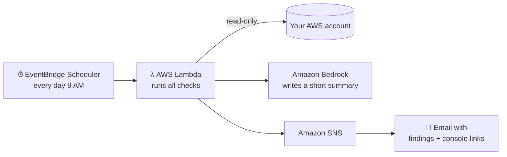

# Build Your First AI Agent with Amazon Bedrock & Strands Agents

### Hands-on Workshop: CloudAdhar Cloud Guardian, an AI agent that protects your AWS account

Starting with AWS? Your two biggest risks are **getting hacked** (an open port, a public bucket) and **getting a surprise bill** (forgotten resources).

In this workshop you'll build an AI agent that checks your own AWS account for both, explains every problem in simple English, and then **runs automatically and emails you a report** with a direct link to fix each issue.

- 🤖 **Amazon Bedrock** (Amazon Nova Pro) is the AI model
- 🧰 **Strands Agents** is the open-source Python SDK from AWS used to build the agent
- 🖥️ **AWS CloudShell** is a terminal in your browser, so nothing is installed on your laptop
- ⏰ **AWS Lambda + EventBridge Scheduler + Amazon SNS** run it automatically and email you

Every AWS step uses the **AWS Console**. No AWS CLI, no access keys.

> Built by **[CloudAdhar](https://youtube.com/@cloudadhar)**, Building Cloud Futures

---

## What you'll build

### Part A: An AI agent you can talk to
```
You: "Is my AWS account secure? Am I wasting money?"
Agent: calls the right checks → explains each problem → gives fix steps + console links
```

### Part B: An automatic guardian that emails you


### The golden rule
> **Python finds the problems. The AI only explains them.**

Python checks the real AWS settings, so the AI can never invent a finding, a resource name, a link or a dollar amount. The agent is **read-only**: it never changes anything in your account.

### What it checks

| Type | Check | Problem when… | Severity |
|---|---|---|---|
| 🔒 Security | Security groups | SSH 22, RDP 3389, MySQL 3306, PostgreSQL 5432, SQL Server 1433, MongoDB 27017, Redis 6379, or ALL traffic open to `0.0.0.0/0` | CRITICAL |
| 🔒 Security | Root user | No MFA | CRITICAL |
| 🔒 Security | S3 buckets | Block Public Access is off | HIGH |
| 🔒 Security | IAM users | No MFA, or active access key > 90 days old | MEDIUM |
| 💰 Cost | EBS volumes | Not attached to any instance | MEDIUM |
| 💰 Cost | Elastic IPs | Not associated with anything (~$3.60/month each) | LOW |
| 💰 Cost | EBS snapshots | Older than 90 days | LOW |
| 💰 Cost | EC2 instances | Stopped for more than 7 days | LOW |

Each finding includes **fix steps**, a **direct AWS Console link**, and for cost findings an **estimated monthly waste in USD** (approximate us-east-1 prices).

---

## Cost of this workshop

| Item | Cost |
|---|---|
| CloudShell, Lambda, EventBridge Scheduler, SNS email | Free (well within Free Tier) |
| Empty S3 bucket, security group, IAM user | Free |
| 1 GiB EBS volume + 1 Elastic IP for ~2 hours | Less than US$0.02 |
| Amazon Bedrock (Nova Pro), a few runs | A few cents |

**Total: a few cents.** Do **Part 8: Clean up** at the end anyway!

---

## Repository structure

```
cloudadhar-cloud-guardian/
├── README.md               <- full workshop guide (you are here)
├── check_setup.py          <- run first: checks Python, login, Bedrock
├── requirements.txt
├── starter/                <- 👩‍💻 YOU WORK HERE
│   ├── checks.py           <- the checks (2 TODOs for you)
│   ├── tools.py            <- turns checks into agent tools
│   └── agent.py            <- the AI agent
├── solution/               <- finished code (peek if stuck)
├── lambda/
│   ├── lambda_function.py  <- paste this into the Lambda Console
│   └── iam-policy.json     <- paste this into the IAM Console
├── tests/                  <- offline tests with fake AWS
├── scripts/build_lambda.py
└── docs/
    ├── PREREQUISITES.md
    └── INSTRUCTOR_NOTES.md
```

---

## Part 1: Before the workshop.

Full checklist: **[docs/PREREQUISITES.md](docs/PREREQUISITES.md)**

1. **Sign in** as an IAM user (or IAM Identity Center user) with **AdministratorAccess**. Not the root user.
2. **Region:** top-right of the Console, choose **US East (N. Virginia) us-east-1**. Use it for everything.
3. **Test Amazon Bedrock:** **Amazon Bedrock** → **Playground** (Chat / Text) → **Select model** → **Amazon** → **Nova Pro** → type `Hello` → **Run**.
   ✅ You get a reply. ❌ If you see an access message, follow the on-screen prompt and try again.

---

## Part 2: Set up CloudShell (10 min)

### 2.1 Open CloudShell
1. Region = **us-east-1** (top right).
2. Click the **CloudShell icon `>_`** in the top bar (next to the search box).
3. Wait about 30 seconds for the terminal.

### 2.2 Python 3.10+
```bash
python3 --version
```
**3.10 or newer?** Skip to 2.3. If it shows **3.9**, install 3.11:
```bash
sudo dnf install -y python3.11
```
> ℹ️ CloudShell keeps your home folder between sessions but resets system packages. In a **new** session, run the `dnf install` line again.

### 2.3 Get the code
**Option A, Git:**
```bash
git clone https://github.com/cloudadhar/cloudadhar-cloud-guardian.git
cd cloudadhar-cloud-guardian
```
**Option B, Upload** (only if you didn't use Option A): GitHub → **Code** → **Download ZIP**. In CloudShell → **Actions** → **Upload file**. Then:
```bash
unzip cloudadhar-cloud-guardian-main.zip && cd cloudadhar-cloud-guardian-main
```

### 2.4 Install
```bash
python3 -m venv ~/venv           # use python3.11 if you installed it in 2.2
source ~/venv/bin/activate
pip install -r requirements.txt
```

### 2.5 Check
```bash
python check_setup.py
```
✅ Four `[PASS]` lines and *"You're ready for the workshop!"*

---

## Part 3: Make some deliberate mistakes in the Console (15 min)

We'll create **3 security mistakes + 2 cost mistakes** so the agent has something to find.

> 🛡️ **All safe:** the bucket is empty, the security group isn't attached to anything, the IAM user has no permissions, and the volume and IP cost less than a cent per hour. You'll delete everything in Part 8.

### 🔒 3.1 S3 bucket with Block Public Access OFF
1. **S3** → **Create bucket** → **General purpose**
2. **Name:** `cloudadhar-demo-<yourname>-<random-number>` (lowercase, globally unique)
3. **Block Public Access settings:** ❌ untick **Block all public access** → tick the acknowledgement box
4. **Create bucket**

### 🔒 3.2 Security group with SSH open to the internet
1. **EC2** (us-east-1) → **Network & Security** → **Security Groups** → **Create security group**
2. **Name:** `cloudadhar-demo-open-ssh` · **Description:** `Workshop demo` · **VPC:** default
3. **Inbound rules** → **Add rule** → **Type:** SSH · **Source:** **Anywhere-IPv4** (`0.0.0.0/0`)
4. **Create security group**

> No default VPC? Pick any VPC. None at all? **VPC** → **Create VPC** → **VPC only** → `10.0.0.0/16` → Create.

### 🔒 3.3 IAM user without MFA
1. **IAM** → **Users** → **Create user**
2. **User name:** `cloudadhar-demo-user` · leave console access **unticked**
3. **Next** → no permissions → **Next** → **Create user**

### 💰 3.4 An EBS volume attached to nothing
1. **EC2** → **Elastic Block Store** → **Volumes** → **Create volume**
2. **Volume type:** gp3 · **Size:** `1` GiB · **Availability Zone:** `us-east-1a`
3. **Add tag** (optional): Key `Name`, Value `cloudadhar-demo-volume`
4. **Create volume**

### 💰 3.5 An Elastic IP not used by anything
1. **EC2** → **Network & Security** → **Elastic IPs** → **Allocate Elastic IP address**
2. Keep defaults → **Allocate**

---

## Part 4: Write the cost checks (20 min)

Open `starter/checks.py`. In CloudShell: `nano starter/checks.py` (save with `Ctrl+O`, `Enter`, exit with `Ctrl+X`).

### 4.1 Read a finished check first
Look at `check_s3_buckets`. Every check:
- uses **read-only** boto3 calls (`list_*`, `describe_*`, `get_*`)
- returns a **list of findings**: dicts with `category`, `resource`, `issue`, `severity`, `fix`, `link`

Try it, with no AI involved:
```bash
cd starter
python -c "import checks; print(checks.check_s3_buckets())"
python -c "import checks; print(checks.check_security_groups())"
```
✅ You see your demo bucket and `cloudadhar-demo-open-ssh`.

### 4.2 TODO 1: `check_unattached_ebs`
Follow the hints (1a, 1b, 1c), then test:
```bash
python -c "import checks; print(checks.check_unattached_ebs())"
```
✅ Your 1 GiB volume, with `est_monthly_usd: 0.08`.

### 4.3 TODO 2: `check_unused_elastic_ips`
```bash
python -c "import checks; print(checks.check_unused_elastic_ips())"
```
✅ Your Elastic IP, with `est_monthly_usd: 3.6`.

> Stuck? Compare with `solution/checks.py`.

### 4.4 How checks become agent tools
Open `starter/tools.py`. Each tool is 3 lines:
```python
@tool
def check_unattached_ebs() -> list:
    """COST: Find EBS volumes not attached to any instance, with estimated monthly waste in USD."""
    return checks.check_unattached_ebs()
```
The **docstring** is what the AI reads to decide *when* to call the tool. Notice the `SECURITY:` and `COST:` prefixes. They help the AI pick the right tools.

---

## Part 5: Talk to your AI agent (15 min)

```bash
python agent.py
```
Watch the agent **call the tools**, then write a report with severity, fix steps, console links and total monthly waste.

Ask your own questions:
```bash
python agent.py "Am I wasting money anywhere?"
python agent.py "Which security problem should I fix first and why?"
python agent.py "Explain my problems in Hindi"
```
Notice that a cost question makes the agent call only the **COST** tools. It decides which tools to use from your question.

Chat mode:
```bash
python agent.py --chat
```

### How the agent loop works
1. Strands sends your question + system prompt + the **list of tools** (names + docstrings) to the model.
2. The model replies: *"call `check_unattached_ebs`"*.
3. Strands runs your Python function and sends the result back.
4. Repeat until the model has enough data, then it writes the answer.

---

## Part 6: Make it automatic, with daily email alerts (30 min)

Now we'll run the checks **on their own, every day**, and email you the report. All in the Console.

> In Lambda we call Bedrock directly with **boto3** (already included in Lambda), so you only need to paste **one file**. No packaging needed.

### 6.1 Create the email topic (Amazon SNS)
1. **Simple Notification Service (SNS)** → **Topics** → **Create topic**
2. **Type:** Standard · **Name:** `cloudadhar-guardian-alerts` → **Create topic**
3. On the topic page → **Create subscription**
   - **Protocol:** Email · **Endpoint:** your email address → **Create subscription**
4. 📧 Open your inbox → email from *AWS Notifications* → click **Confirm subscription**
   *(Check spam/promotions if you don't see it.)*
5. Back on the topic page, **copy the Topic ARN** (looks like `arn:aws:sns:us-east-1:123456789012:cloudadhar-guardian-alerts`)

### 6.2 Create the Lambda function
1. **Lambda** → **Create function** → **Author from scratch**
2. **Function name:** `cloudadhar-guardian`
3. **Runtime:** the newest **Python 3.x** in the list · **Architecture:** x86_64
4. **Permissions:** *Create a new role with basic Lambda permissions*
5. **Create function**

### 6.3 Paste the code
1. In GitHub, open **`lambda/lambda_function.py`** → click the **Copy raw file** button (📋 icon, top right of the file)
2. In the Lambda **Code** tab, open `lambda_function.py`, **select all and delete**, then **paste**
3. Click **Deploy** ✅

### 6.4 Settings
1. **Configuration** → **General configuration** → **Edit**
   - **Timeout:** `1 min 0 sec` · **Memory:** `256` MB → **Save**
2. **Configuration** → **Environment variables** → **Edit** → **Add environment variable**
   - **Key:** `TOPIC_ARN` · **Value:** *(paste your Topic ARN)* → **Save**

### 6.5 Give Lambda read-only permissions
1. **Configuration** → **Permissions** → click the **Role name** link (opens IAM)
2. **Add permissions** → **Create inline policy** → **JSON** tab
3. Delete what's there and paste the contents of **`lambda/iam-policy.json`** from GitHub
4. **Next** → **Policy name:** `cloudadhar-guardian-checks` → **Create policy**

> 👀 Read the policy. It only allows **List / Describe / Get** actions, plus Bedrock and publishing to *your* SNS topic. This is **least privilege**: Lambda can look, but can't change anything.

### 6.6 Test it, and get your first email 📧
1. Back in Lambda → **Test** tab → **Event name:** `test` → leave the JSON as `{}` → **Test**
2. ✅ "Execution result: succeeded"
3. 📧 Check your inbox: *"Cloud Guardian: N findings (1 critical) in your AWS account"*
4. **Click a link** in the email. It opens the exact resource in the AWS Console!

### 6.7 Schedule it (EventBridge Scheduler)
1. **Amazon EventBridge** → **Scheduler** → **Schedules** → **Create schedule**
2. **Schedule name:** `cloudadhar-guardian-daily`
3. **Schedule pattern:** **Recurring schedule** → **Cron-based schedule**
   - Minutes `0` · Hours `9` · Day of month `*` · Month `*` · Day of week `?` · Year `*`
   - **Time zone:** `Asia/Calcutta` (or your time zone)
   - **Flexible time window:** Off
4. **Next** → **Target:** **AWS Lambda – Invoke** → **Lambda function:** `cloudadhar-guardian`
5. **Next** → **Permissions:** *Create new role for this schedule* → **Next** → **Create schedule**

🎉 You'll now get a security and cost report **every morning at 9 AM**.

> **Workshop tip:** to see the schedule fire during class, choose **Rate-based schedule** → `5 minutes` instead, then change it back to daily (or delete it) afterwards.

---

## Part 7: Fix one issue, then verify (10 min)

1. Open the **security group link** from your email (or the agent's report)
2. **Inbound rules** → **Edit inbound rules** → change **Source** to **My IP** (or **Delete**) → **Save rules**
3. Release the Elastic IP: **EC2** → **Elastic IPs** → select it → **Actions** → **Release Elastic IP addresses**
4. Run again, either way:
   - CloudShell: `python agent.py`
   - Lambda: **Test** → new email 📧
5. ✅ The CRITICAL finding and the $3.60 waste are gone. **Detect → fix → verify**, just like real cloud engineers.

---

## Part 8: Clean up (10 min). Don't skip this!

| # | Delete | Where |
|---|---|---|
| 1 | Schedule `cloudadhar-guardian-daily` | EventBridge → Scheduler → Schedules → select → **Delete** |
| 2 | Lambda `cloudadhar-guardian` | Lambda → Functions → select → **Actions** → **Delete** |
| 3 | SNS topic `cloudadhar-guardian-alerts` | SNS → Topics → select → **Delete** (and Subscriptions → delete yours) |
| 4 | EBS volume `cloudadhar-demo-volume` | EC2 → Volumes → select → **Actions** → **Delete volume** |
| 5 | Elastic IP (if not released yet) | EC2 → Elastic IPs → **Actions** → **Release** |
| 6 | Security group `cloudadhar-demo-open-ssh` | EC2 → Security Groups → **Actions** → **Delete** |
| 7 | S3 bucket `cloudadhar-demo-...` | S3 → select → **Delete** → type name |
| 8 | IAM user `cloudadhar-demo-user` | IAM → Users → **Delete** |
| 9 | IAM roles `cloudadhar-guardian-role-...` and `Amazon_EventBridge_Scheduler_LAMBDA_...` | IAM → Roles → search → **Delete** |
| 10 | Log group `/aws/lambda/cloudadhar-guardian` | CloudWatch → Log groups → **Actions** → **Delete** |

> Want to **keep** your guardian running on your real account? Keep 1–3 and 9, and delete only the demo resources (4–8). It costs practically nothing.

---

## Bonus challenges

1. **New cost check:** find load balancers with no targets (`elbv2.describe_load_balancers` + `describe_target_health`).
2. **New security check:** find EBS volumes that are **not encrypted** (`Encrypted == False`).
3. **Multi-region:** loop over all regions with `ec2.describe_regions()`.
4. **Only email when something is CRITICAL:** change one line in `lambda_handler`.
5. **Real-time alerts (advanced):** instead of a daily schedule, trigger Lambda the moment someone opens a port, with an **EventBridge rule** on the `AuthorizeSecurityGroupIngress` API call. *(Requires a CloudTrail trail to be enabled.)*
6. **Change the personality:** make the agent answer in Hindi or Marathi, or as a strict auditor.

After changing `solution/checks.py`, rebuild the Lambda file: `python scripts/build_lambda.py`

---

## Troubleshooting

| Problem | Fix |
|---|---|
| `check_setup.py`: Python FAIL | `sudo dnf install -y python3.11`, then recreate venv: `python3.11 -m venv ~/venv` |
| `ModuleNotFoundError: strands` | `source ~/venv/bin/activate` then `pip install -r requirements.txt` |
| `bad interpreter` in a new CloudShell session | `sudo dnf install -y python3.11` again |
| Bedrock `AccessDeniedException` | Region must be **us-east-1**; test the model in the Bedrock **Playground** |
| `check_setup.py` says *"Check region is eu-west-1"* (or another region) | CloudShell uses the region selected in the Console. Switch to **us-east-1** and open CloudShell again (each region has its own CloudShell home folder, so clone and install again) |
| `ThrottlingException` | Wait 30 seconds and retry (the whole class is calling Bedrock at once) |
| `ThrottlingException ... Too many tokens per day` | Your account's **daily** Bedrock quota is used up (common on new accounts). Waiting a few minutes won't help. Try **us-east-1**, or **Service Quotas** → **Amazon Bedrock** → search `Nova Pro` → **Request increase** |
| A check returns `[]` | Correct if nothing is wrong! Otherwise, check you created resources in **us-east-1** |
| Lambda: `Task timed out after 3.00 seconds` | Set **Timeout** to 1 minute (step 6.4) |
| Lambda: `AccessDenied ... ec2:Describe...` | Inline policy missing. Redo step 6.5 |
| Lambda succeeded but **no email** | Did you **confirm** the subscription email? Is `TOPIC_ARN` correct? Check spam |
| Email says *"AI summary unavailable"* | Bedrock call failed (permissions/model access). The findings are still correct. Check the policy's Bedrock section |
| Lambda: `AuthorizationError ... sns:Publish` | Your topic must be named exactly `cloudadhar-guardian-alerts` in us-east-1 (or edit the policy) |
| Email says "Root user has no MFA" | That's a real finding. Please enable MFA on your root user! |

---

## Run the tests (optional, no AWS needed)
```bash
pip install -r requirements-dev.txt
pytest -q
```
Uses **moto** to fake AWS. 12 tests cover every check and the Lambda email.

---

## Security notes
- All checks are **read-only**. Nothing in your account is ever changed by the code or the AI.
- CloudShell and Lambda use **IAM roles**, so there are **no access keys** anywhere.
- The Lambda policy is **least privilege**: only the exact read actions it needs.
- Only finding metadata (resource names, issues) is sent to Bedrock, never your data.

---

## License
MIT. Free for learning and teaching. Please credit **CloudAdhar** when sharing.

**Follow CloudAdhar:** [YouTube](https://youtube.com/@cloudadhar) · [Instagram](https://instagram.com/cloudadhar) · [LinkedIn](https://linkedin.com/in/gangadharure)
